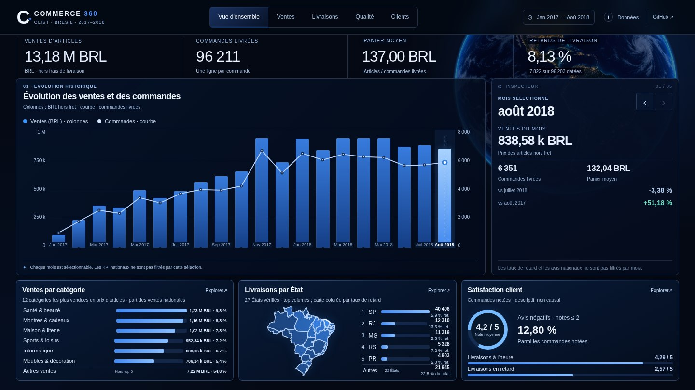
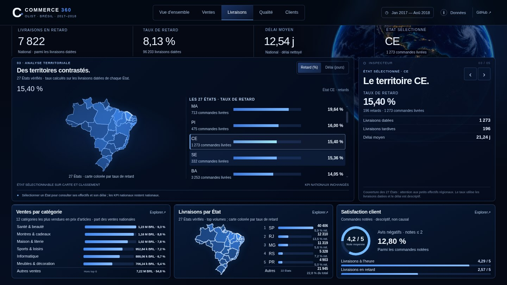
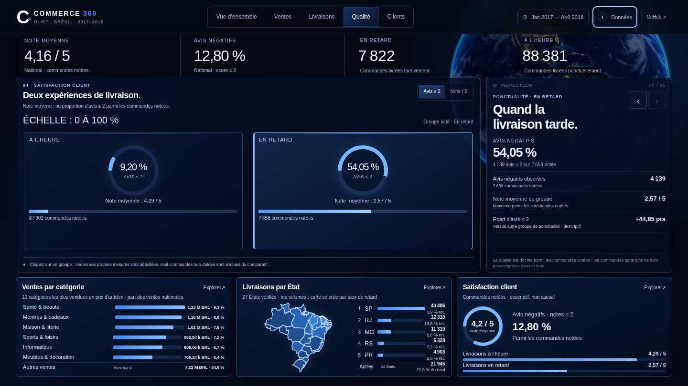
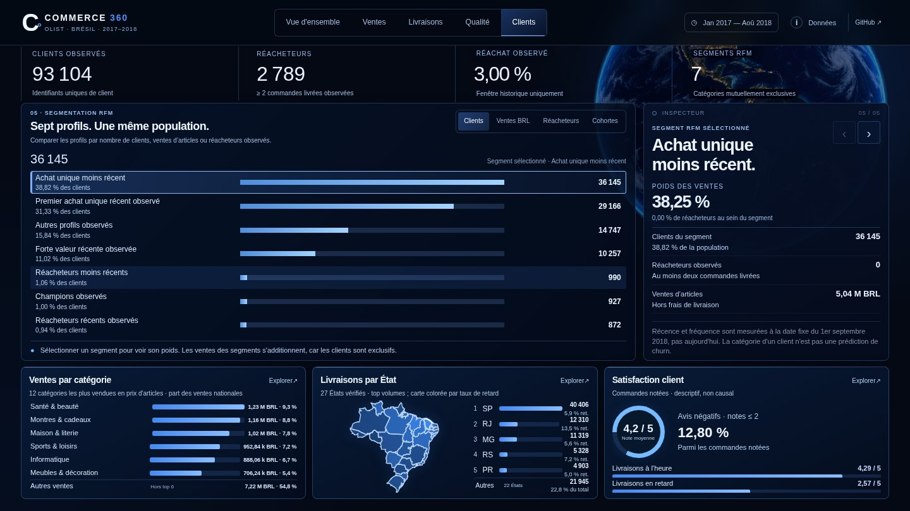

# Commerce 360 — Présentation portfolio et candidature

**Statut :** projet personnel Data Analyst publié le **19 octobre 2026** · Étude indépendante sur les données historiques **Olist (Brésil, janvier 2017 – août 2018)**.

**[Ouvrir la démo interactive](https://commerce-360-explorer.vercel.app/)** · **[Voir le code source](https://github.com/sogoyou8/commerce-360)** · **[Lire les résultats et limites](e8-bilan.md)** · **[Reproduire l'analyse](e8-reproduction.md)**

> Les ventes indiquées correspondent aux **prix des articles des commandes livrées, hors frais de livraison**. Il ne s'agit ni du chiffre d'affaires net ni d'un résultat actuel d'Olist. Le rapport Power BI et les exports détaillés sont conservés localement ; la démo web publique ne montre que des agrégats.

## Fiche projet — prête à intégrer à un portfolio

| Élément | Présentation |
|---|---|
| **Projet** | Commerce 360 — des données transactionnelles aux décisions commerciales |
| **Rôle** | Projet individuel : modélisation SQL, nettoyage, contrôles, analyse, RFM, visualisation et démo web |
| **Périmètre** | Neuf sources Olist ; ventes, livraisons, satisfaction et comportements clients |
| **Période** | 1er janvier 2017 inclus au 1er septembre 2018 exclu |
| **Stack** | PostgreSQL 16, SQL, Python, Docker, Excel, Power Query, Power BI Desktop, DAX, HTML/CSS/JavaScript, GitHub Actions et Vercel |
| **Livrables** | Pipeline documenté E0–E8, rapport Power BI de cinq pages **local**, dashboard web public de cinq vues, contrôles et référentiels agrégés |
| **Démo** | https://commerce-360-explorer.vercel.app/ |
| **Code** | https://github.com/sogoyou8/commerce-360 |

## Résumé court — carte portfolio

**Commerce 360** est une étude de cas Data Analyst menée à partir de neuf fichiers e-commerce historiques Olist. J'ai construit une chaîne de traitement et de contrôle avec PostgreSQL, SQL et Python, puis analysé les ventes, les livraisons, les avis et les comportements clients dans Excel/Power BI et un dashboard web interactif. Le périmètre étudié représente **96 211 commandes livrées**, **13,18 millions BRL de ventes d'articles hors fret** et **93 104 clients observés**. Les indicateurs sont réconciliés, les dénominateurs explicités et les limites de l'étude documentées.

## Étude de cas — texte détaillé

### 1. Problème métier

Comment réunir neuf sources transactionnelles sans compter plusieurs fois une commande, un article ou un client, puis obtenir une lecture fiable des ventes, de la ponctualité des livraisons, de la satisfaction et des profils d'achat ?

### 2. Construction et décisions techniques

J'ai distingué les grains **commande**, **article**, **client** et **avis**, préparé les données dans PostgreSQL, créé des vues SQL métier et utilisé Python pour contrôler les volumes et les agrégats. Excel/Power Query et Power BI/DAX ont servi à restituer les analyses. Une démo web statique distincte présente uniquement des synthèses publiables, sans accès à la base SQL ni aux données individuelles.

Les étapes E0–E8, les cinq pages Power BI locales et les cinq vues web sont documentées. Les contrôles automatisés et les rapprochements SQL/Power BI sont distingués des vérifications locales qui ne peuvent pas être reproduites depuis GitHub.

### 3. Résultats vérifiés

| Mesure historique | Résultat |
|---|---:|
| Commandes livrées | **96 211** |
| Prix des articles livrés, hors fret | **13 181 027,13 BRL** |
| Clients uniques observés | **93 104** |
| Retards parmi les livraisons datées | **7 822 / 96 203 — 8,13 %** |
| Part d'avis négatifs parmi les livraisons **à l'heure et notées** | **9,20 %** |
| Part d'avis négatifs parmi les livraisons **en retard et notées** | **54,05 %** |
| Segments RFM descriptifs et exclusifs | **7** |
| États brésiliens dans la comparaison des livraisons | **27** |

**Enseignement métier :** les avis négatifs sont beaucoup plus fréquents dans le groupe des livraisons en retard que dans celui des livraisons ponctuelles. C'est une **association descriptive**, pas une preuve que le retard cause à lui seul l'avis négatif. La segmentation RFM décrit des achats observés pendant une période historique, sans prédiction de churn ni de fidélité actuelle.

### 4. Validation et limites

La PR web et sa finition ont été fusionnées dans `main` ([PR #7](https://github.com/sogoyou8/commerce-360/pull/7) et [PR #9](https://github.com/sogoyou8/commerce-360/pull/9)). La recette de publication a contrôlé les cinq vues en production sur ordinateur et mobile, le chargement des agrégats et l'absence de débordement horizontal ou d'erreur JavaScript détectée. Les workflows GitHub Web demo et Python quality ont réussi avant la fusion de la PR #9.

**Réserve d'accessibilité :** les audits automatisés axe-core n'ont pas détecté de violation dans les vues et formats contrôlés, mais **aucun test humain NVDA ou VoiceOver n'a été effectué**. Aucune certification WCAG n'est revendiquée. Le PBIX, les exports détaillés et le classeur Excel restent locaux ; le PBIX n'a pas été audité automatiquement par GitHub.

## Galerie de captures — démo web publiée

Captures de la **version web de production** réalisées le 19 octobre 2026 en 1440 × 810. Elles illustrent des agrégats historiques et **ne sont pas des captures du rapport Power BI local**.

### Vue d'ensemble — évolution de l'activité

### Livraisons — territoires et ponctualité

### Qualité — ponctualité et satisfaction

### Clients — segmentation RFM

## Texte CV — prêt à adapter

**Commerce 360 | Projet Data Analyst — SQL, Python, Power BI, DAX, Power Query**

- Structuration et contrôle de **9 sources Olist** dans PostgreSQL, avec gestion des grains commande, article, client et avis pour limiter les doubles comptages.
- Analyse de **96 211 commandes livrées**, **13,18 M BRL de ventes d'articles historiques hors fret** et **93 104 clients observés**, avec segmentation RFM en **7 groupes**.
- Construction d'un rapport Power BI local de **5 pages** et publication d'un dashboard web de **5 vues**, avec contrôles SQL/Python, CI GitHub et documentation des limites.

## Pitch oral — environ 45 secondes

« Commerce 360 est un projet Data Analyst complet sur les données historiques Olist. Le principal défi était de réunir neuf fichiers qui n'avaient pas tous le même niveau de détail, sans créer de doubles comptages. J'ai construit des vues métier PostgreSQL, automatisé des validations en Python, puis restitué les analyses dans Power BI et une démo web interactive. Le périmètre couvre environ 96 000 commandes livrées et 93 000 clients observés. Un résultat intéressant est l'association entre les retards de livraison et la fréquence des avis négatifs, que je présente comme un constat descriptif, pas comme une causalité. Le code, les tests, les définitions des KPI et le dashboard sont consultables sur GitHub et Vercel. »

## Proposition de publication LinkedIn — à personnaliser

**Commerce 360 — mon projet Data Analyst de bout en bout**

Comment passer de neuf fichiers e-commerce à des indicateurs fiables et compréhensibles ?

Avec les données historiques Olist (Brésil, 2017–2018), j'ai construit un pipeline PostgreSQL/SQL et Python, des analyses Excel et Power BI, une segmentation RFM et un dashboard web interactif.

Le projet couvre **96 211 commandes livrées**, **13,18 M BRL de ventes d'articles hors fret** et **93 104 clients observés**. Il met notamment en évidence une association entre les retards de livraison et les avis négatifs, sans en déduire de causalité.

La démo et le code sont publics ; les données individuelles et les fichiers détaillés restent locaux.

🔗 Démo : https://commerce-360-explorer.vercel.app/

🔗 GitHub : https://github.com/sogoyou8/commerce-360

#DataAnalytics #SQL #Python #PowerBI #DataVisualization

## Conditions de réutilisation et transparence

- Ne présenter aucun résultat comme un chiffre actuel, officiel ou net d'Olist.
- Ne pas publier les CSV bruts, identifiants clients, fichiers PBIX, classeurs détaillés, chemins locaux ou secrets.
- Les captures ci-dessus sont celles de la **démo web**, non du Power BI local ; vérifier leur contexte avant tout recadrage ou réutilisation.
- Les métriques, leur grain et leurs dénominateurs sont détaillés dans [le bilan analytique](e8-bilan.md).
- Conserver la réserve **NVDA/VoiceOver non testé** et ne pas revendiquer de certification d'accessibilité.
